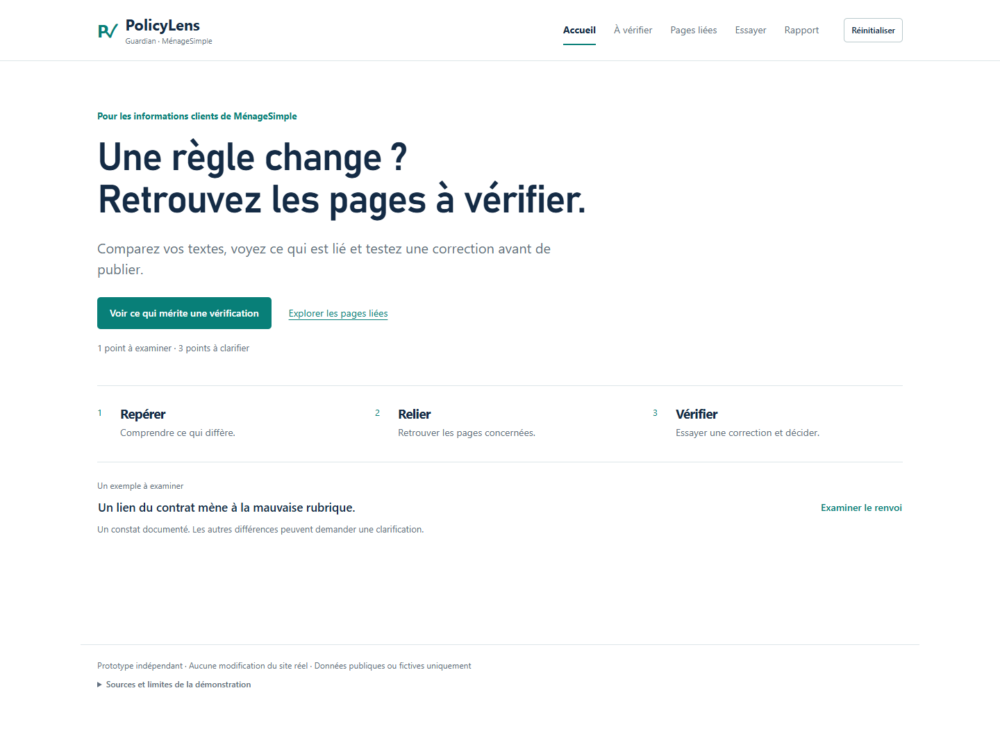
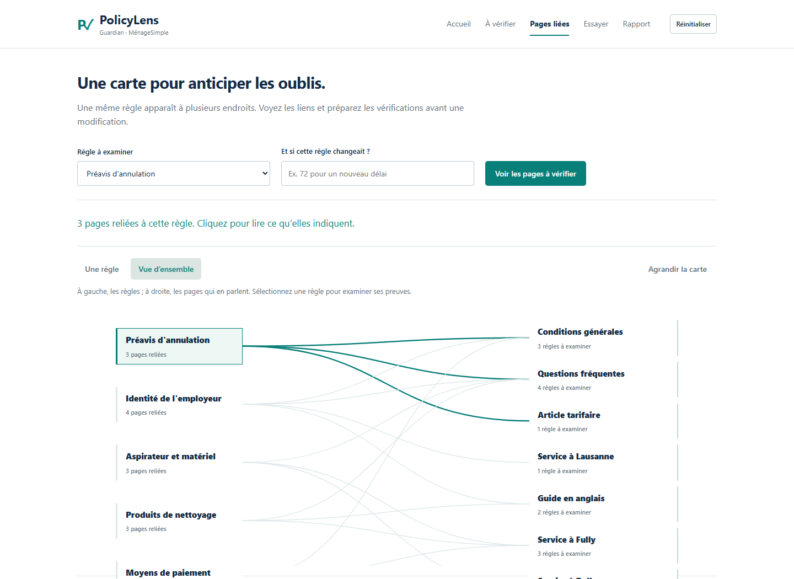
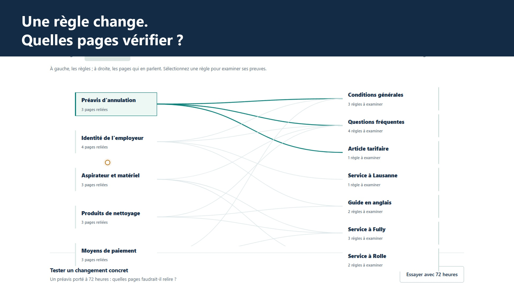

# PolicyLens Guardian

**Vérifier. Relier. Corriger.** Une application web de démonstration en français pour MénageSimple, développée dans le cadre du recrutement Stonks Holding AG.

> **English.** An evidence-first, French-language policy consistency review prototype. It compares structured statements, links related indexed claims and policies in an impact graph, simulates corrections, supports human review, and exports reports. It does not crawl arbitrary URLs or edit the company's production site.

**Démonstration HTTPS :** https://policylens.54-173-165-46.sslip.io/ . La version intégrant le graphe et les cinq sujets a été déployée et vérifiée le 12 novembre. Les résultats distants sont dans `docs/validation/aws`. La [vidéo finale française de 2 min 56](https://youtu.be/F2_ufmoYtuc) montre le vrai parcours déployé, avec narration de synthèse et sous-titres.

## Le besoin métier

Une modification de règle d'annulation peut demander une vérification des CGV, FAQ, pages tarifaires et pages de service. PolicyLens met en évidence les **références indexées** à examiner pour réduire les oublis, sans affirmer avoir exploré tout le site. L'étude de référence comporte 7 pages et 17 affirmations structurées. Les données factuelles proviennent d'un registre de sources sélectionnées manuellement et sont accompagnées de dates et de réserves.

## Fonctionnalités

1. **Vérifications de cohérence.** Comparaison déterministe des délais d'annulation, pourcentages de frais tardifs, renvois contractuels et informations nécessitant un jugement de contexte (employeur, matériel, produits, modalités de paiement). Des variantes légitimes de service ne sont pas déclarées fautives automatiquement.
2. **Graphe des politiques et analyse d'impact.** Une page dédiée propose une vue d’ensemble interactive, une vue centrée sur une règle, un mode plein écran et une liste d’actions après simulation. Elle relie cinq politiques à leurs pages, affirmations et clauses. Une liste lisible précise les preuves et les statuts pour les seules pages indexées. Une règle hypothétique de 72 h peut révéler les pages à examiner.
3. **Simulations et revérification.** Correction du texte historique dans Guardian, ainsi qu'ajout/correction d'une affirmation structurée dans le graphe ; vrais recalculs déterministes, résultats avant/après, réinitialisation, aucune écriture vers MénageSimple.
4. **Preuves et validation humaine.** Citations et URL sources, observation historique/actuelle/non vérifiée, revue humaine avec décision et note. Les affirmations ajoutées par un utilisateur restent toujours « fournies par le réviseur ».
5. **Outils métier.** Tableau de bord, calculateur de frais CHF, contrôle de renvois entre clauses, rapport HTML imprimable, rapport JSON principal incluant les informations du graphe, rapport JSON d'impact.

L'ancien différend 24 h / 48 h est un **cas historique**, pas une incohérence active confirmée. Le renvoi de §7 vers §10d alors que la disposition d'annulation figure en §10c est un cas de référence nécessitant une relecture du texte en vigueur avant toute publication d'un résultat métier. Les descriptions des rôles d'employeur, de matériel et de paiement nécessitent une analyse des prestations et du contrat applicable.

Le point **« Carte, virement ou espèces ? »** est intégré à « À vérifier », aux décisions et aux rapports. Les anciens extraits des pages locales n’ont pas été retrouvés le 12 novembre : ils sont affichés comme non authentifiés, jamais comme preuve d’une contradiction actuelle.

### Démonstration en moins de trois minutes

Ouvrir le tableau de bord, examiner le problème de renvoi contractuel et ses sources ; choisir « Préavis d'annulation » dans le graphe ; proposer 72 h et examiner la liste ; saisir une information **synthétique** à 12 h sur `https://menagesimple.com/` puis corriger localement sa valeur à 48 h ; observer la revérification ; exporter le rapport. Voir `docs/demo-fr.md` pour le script exact.

## Lancement

Python 3.9+ sans dépendances applicatives supplémentaires :

```sh
python server.py --ephemeral
```

Ouvrir `http://127.0.0.1:8879/`. Pour conserver les décisions de revue entre deux lancements locaux, lancer sans `--ephemeral`. Le graphe de démonstration est **en mémoire** et se réinitialise à chaque nouveau processus.

Adaptateur public avec isolation des sessions et limites de ressources :

```sh
LOCAL_PUBLIC_TEST=1 BIND_HOST=127.0.0.1 PORT=8080 python public_server.py
```

`LOCAL_PUBLIC_TEST=1` est exclusivement destiné aux tests HTTP locaux ; en production, laisser cette variable absente, servir derrière un proxy HTTPS et configurer `PUBLIC_HOST`. Chaque navigateur bénéficie d'une session distincte ; les corrections de graphe et de Guardian ne sont pas communes. L'application n'interprète aucune URL ni ne télécharge de site au cours de la saisie d'un exemple.

## Tests et reproductibilité

```sh
python -m unittest discover -v
python -m py_compile *.py
node --check app.js
node --check impact.js
node --check navigation.js
node --check graph-explorer.js
```

Les **106 tests Python** ont été exécutés avec succès le 12 novembre 2026 après les corrections et la simplification de l’interface. Le journal est conservé dans `docs/audit/tests-final-local.txt`. Le contrôle du navigateur est exécuté séparément par `browser_release.cjs` ; ses 116 contrôles datés figurent dans `docs/validation/browser/results.json`. Les 24 contrôles ciblés sur le paiement et la carte sont dans `docs/validation/browser/graph-explorer-results.json`. Ces contrôles locaux ne prouvent pas un déploiement sur AWS.

L’interface affiche une rubrique à la fois : **Accueil**, **À vérifier**, **Pages liées**, **Essayer**, **Rapport**. Dans **Essayer**, trois onglets séparent la correction historique, la comparaison d’une saisie et le calculateur. Les preuves supplémentaires et les décisions se déplient à la demande.

**Présentation validée par Marwane le 12 novembre 2026.** La publication, le déploiement et la vérification HTTPS sont terminés ; leurs résultats sont disponibles dans docs/validation/aws.

## Architecture

Une seule application Python et une seule interface HTML/CSS/JS : `guardian.py`, `engine.py`, `public_server.py`, `server.py`, `impact_graph.py` et `impact_integration.py`. Le module du graphe est intégré dans la page et dans l'adaptateur HTTP de Guardian. `sources.json` reste le registre de référence ; `impact_evidence.json` contient des affirmations structurées à rapprocher de ce registre. Les affirmations sans concordance textuelle sont marquées comme index ancien. Le système ne dispose ni de base de données de graphe, ni de modèle IA à l'exécution, ni d'un robot de collecte.

**Limites :** la saisie structurée est contrôlée mais n'interprète pas automatiquement un nouveau site ; une valeur numérique compatible n'établit pas la validité complète d'une clause ; une source indexée ne prouve pas sa présence actuelle sur le site. Les simulations n'ont aucune valeur juridique et ne modifient aucune réservation. Ce projet de recrutement indépendant n'est pas une application officielle de MénageSimple.

## Publication / récupération

La mise à jour utilise le service existant, sans modifier Nodum. Voir `docs/deployment-aws.md` pour le déploiement, ses limites financières et son retour arrière ; ne pas intervenir sur les services voisins. Préserver le commit de référence GitHub `02d01073622204b710fafc819f68d1c7707ed2af` comme checkpoint de récupération. Les contrôles de la version déployée ont réussi.

Code : https://github.com/marwanehmamouchi05/PolicyLens-MenageSimple-Guardian

Licence MIT. Les citations restent la propriété de leurs auteurs ; voir `THIRD_PARTY_NOTICES.md`.

## Preuves et présentation





Les fonctions et leurs limites sont décrites ci-dessus. Voir la [validation reproductible](docs/validation.md).

## Validation sur le site réel

106 tests Python ont passé sur l’hôte AWS, puis 116 contrôles de parcours et 24 contrôles ciblés ont réussi sur le domaine HTTPS : rapports réellement téléchargés, deux sessions distinctes, simulation, revue, mobile, clavier et plein écran. Les six fichiers de l’interface servis en ligne correspondent octet pour octet à la version vérifiée. Voir [les preuves distantes](docs/validation/aws/deployment.json).

[](https://youtu.be/F2_ufmoYtuc)

Disponibilité de la démonstration prévue jusqu’à la fin du 12 décembre 2026, heure du Maroc. Le service voisin Nodum reste inchangé.
