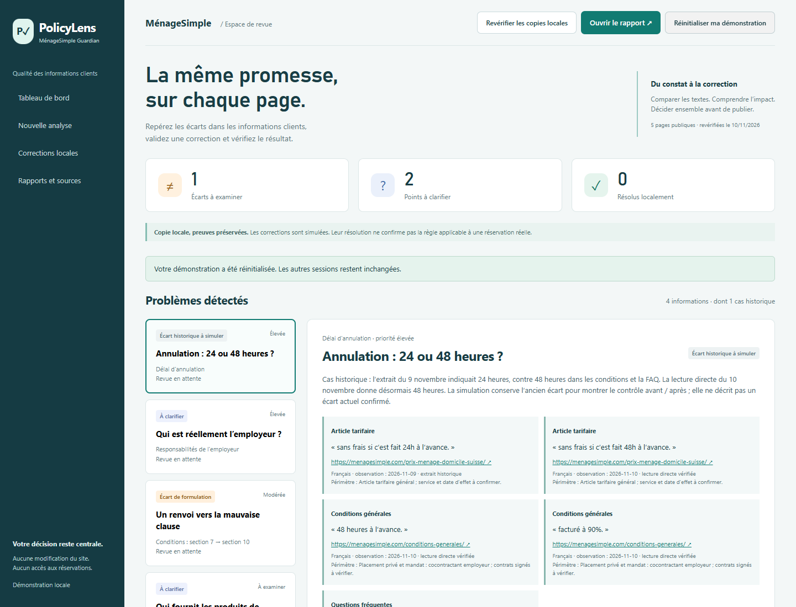
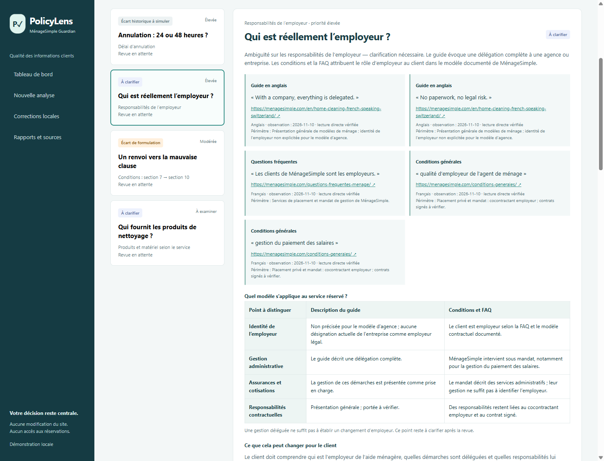

# PolicyLens Guardian

**Contrôle de cohérence des engagements clients — Démonstration MénageSimple**

PolicyLens transforme des formulations dispersées en constats documentés, puis en décisions de clarification ou de correction. Ce prototype de recrutement est indépendant : ce n’est pas un produit officiel de MénageSimple et il ne bénéficie d’aucune approbation revendiquée de l’entreprise.

> **English introduction.** A focused, French-language policy-consistency review tool: dated evidence, conservative comparisons, human decisions and a genuine local correction/recheck workflow. No production-site editing, runtime AI inference or autonomous crawling.

[Application HTTPS](https://policylens.54-173-165-46.sslip.io/) · [Présentation française — 2 min 55](https://youtu.be/W54PfL6ECXQ) · [Code source](https://github.com/marwanehmamouchi05/PolicyLens-MenageSimple-Guardian) · [Démarrer](#démarrage-local) · [Tests](#tests-et-validation) · [Script français](docs/narration-fr.txt)

**Publication vérifiée le 11 novembre 2026 :** [application AWS](https://policylens.54-173-165-46.sslip.io/), accessible sans compte. Disponibilité prévue jusqu’au 12 décembre inclus (heure du Maroc). La [présentation française de 2 min 55](https://youtu.be/W54PfL6ECXQ) est publiée en non répertoriée : vraie capture AWS, narration de synthèse française suisse, légendes et sous-titres. Lecture testée ; requête sans cookie : HTTP 200, vidéo lisible, non privée.



## Le besoin métier

Un client doit comprendre le délai d’annulation, les fournitures à prévoir et son rôle dans la relation de service, quelle que soit la page consultée. Une différence peut être une erreur éditoriale, une évolution de version ou une différence légitime de périmètre. PolicyLens garde ces possibilités visibles et propose une action métier.

| Catégorie | Preuves sélectionnées | Traitement |
|---|---|---|
| Annulation | [Article tarifaire](https://menagesimple.com/prix-menage-domicile-suisse/), [conditions](https://menagesimple.com/conditions-generales/), [FAQ](https://menagesimple.com/questions-frequentes-menage/) | Cas historique 24 h / 48 h du 9 novembre ; la lecture directe du 10 novembre donnait 48 h. Démonstration datée, sans prétendre à un écart actuel confirmé. |
| Employeur | [Guide anglais](https://menagesimple.com/en/home-cleaning-french-speaking-switzerland/), conditions et FAQ | Distinguer le rôle d’employeur et la gestion déléguée. Le guide actuel ne désigne pas explicitement l’agence comme employeur légal. Contexte à confirmer. |
| Renvoi contractuel | Conditions, sections 7 et 10 | Renvoi 10d, photographie ; annulation sous 10c dans la capture du 10 novembre. |
| Produits et matériel | [Accueil](https://menagesimple.com/), guide et FAQ | Distinguer produits inclus, matériel du client, services et options. Point de clarté à examiner. |

Les sources sont sélectionnées manuellement, pas découvertes automatiquement. `sources.json` conserve les citations exactes, dates, langues, périmètres et empreintes des captures. Les preuves anglaises restent dans leur langue ; les explications sont françaises. Les pages peuvent changer après la vérification.

## Fonctionnalités visibles

- Quatre catégories de constats, priorités, compteurs calculés et preuves comparées.
- Revue humaine : accepter, modifier, rejeter ou demander une précision. Une acceptation ne résout pas automatiquement le contexte employeur.
- Correction d’une copie locale, recalcul effectif et historique avant/après. Une nouvelle différence fait réapparaître le constat.
- Nouvelle règle structurée : délai d’annulation ou pourcentage de frais tardifs. Exemple : 12 h relève un écart ; 48 h est compatible si le contexte concorde. L’extrait libre n’est pas interprété et l’URL déclarée n’est pas vérifiée.
- Calculateur décimal : deux heures à CHF 43.90 donnent CHF 87.80 ; 90 % représentent CHF 79.02. Illustration d’attentes possibles, jamais une perte mesurée.
- Rapport HTML français imprimable et rapport JSON français avec décisions et historique.



## La correction et sa revérification

1. Examiner le cas historique d’annulation et ses preuves datées.
2. Charger la correction proposée dans la copie locale.
3. Indiquer explicitement les hypothèses sur le service et les conditions.
4. Appliquer et revérifier : le moteur compare les nouvelles données ; à 48 h, le contrôle simulé est résolu.
5. Remplacer 48 par 72 : l’écart revient. Revenir à 48 : le contrôle est à nouveau compatible.

Le texte du site n’est jamais modifié. Un texte non pris en charge ou des conditions non confirmées ne peuvent pas produire une résolution injustifiée. Une modification du contenu ou des preuves invalide l’approbation associée à leur ancienne version.

## Démarrage local

Python 3.9+ (58 tests également exécutés sur Python 3.9.25 dans AWS) ; aucune dépendance d’application à installer.

```text
python server.py --ephemeral
```

Ouvrir http://127.0.0.1:8879. Arrêter avec Ctrl+C. Pour conserver les décisions sur votre ordinateur, utiliser `python server.py` ; `local-state.json` est ignoré par Git. Pour changer de port : `python server.py --ephemeral --port 8880`.

### Adaptateur public

```text
python public_server.py
```

Il lit `PORT` (8080 par défaut), `BIND_HOST` (`0.0.0.0` par défaut) et `PUBLIC_HOST` (nom HTTPS autorisé) et fournit `/api/health`. Par défaut, ses cookies sont réservés à HTTPS. Pour tester exclusivement sur cet ordinateur en HTTP, définir `LOCAL_PUBLIC_TEST=1` avant le lancement ; ne jamais activer cette variable dans AWS.

Chaque navigateur possède un état temporaire isolé, expirant après 30 minutes d’inactivité. Un bouton réinitialise sa propre démonstration. Les données ne sont pas conservées entre redémarrages du service. Ne pas saisir de données sensibles.

## Tests et validation

```text
python -m unittest discover -v
```

La copie de publication a passé **58 tests Python** : 53 cas métier et HTTP existants, plus 5 contrôles de l’adaptateur public (isolation, réinitialisation, attributs du cookie, origine et limites de requêtes). Voir [le journal](docs/validation-python.txt). La syntaxe JavaScript est vérifiée.

Le parcours de la copie publique a passé 66 assertions navigateur sur l’adaptateur local : les 64 contrôles métier et deux vérifications d’isolation / réinitialisation. Voir docs/validation-browser-public-local.json. Les mêmes 66 assertions passent également sur le véritable domaine HTTPS AWS, sans erreur JavaScript non traitée : [résultats distants](docs/validation-browser-aws.json). Les deux exécutions sont distinguées dans [le dossier de validation](docs/validation.md).

## Architecture et sécurité du démonstrateur

Le moteur Python déterministe est inchangé. `guardian.py` gère les constats et le workflow ; `employer.py` ajoute les distinctions de rôles ; `new_information.py` adapte les saisies numériques au moteur. L’interface utilise HTML, CSS et JavaScript. `report_fr.py` produit les rapports.

`public_server.py` ajoute uniquement une frontière HTTP publique : sessions aléatoires, cookies HttpOnly/SameSite/HTTPS, état en mémoire, plafond de sessions, durée de vie et nombre d’actions bornés, limite de requêtes et de connexions, vérification d’origine et liste fermée des fichiers accessibles. Aucun modèle public coûteux, robot d’exploration, téléchargement de fichiers utilisateur, écriture externe ou base de données.

Ces limites réduisent l’exposition d’un petit démonstrateur ; elles ne constituent pas une certification de sécurité ni une protection anti-DDoS complète. Le déploiement réel utilise un service isolé sur un serveur EC2 existant, limité à 160 Mio et 25 % d’un cœur, derrière Caddy. Utiliser uniquement des données publiques ou fictives.

## Pourquoi un moteur ciblé plutôt qu’une IA à l’exécution ?

Un projet de recherche séparé a exploré Qwen3 8B. Dans les comptes rendus archivés du 8 novembre 2026, retained-v1 et coherent obtiennent chacun 19/24 décisions exactes et conservent 5/5 contrôles positifs connus. Des faux positifs subsistent. Les cas sont des données de développement ; certains négatifs ont été revus par un agent, pas par une annotation humaine indépendante authentifiée.

Ces résultats n’ont pas été remesurés ici et ne sont pas un comparatif direct prouvant une meilleure précision de Guardian. Le choix du démonstrateur est une décision de portée : une application reproductible, des preuves explicites et une revue humaine, avec une simulation fiable. Guardian n’utilise pas Qwen, n’a pas été entraîné ou spécialisé et n’intègre pas V10. Voir [la synthèse d’ingénierie](docs/engineering.md).

## Vérification humaine et limites

Confirmer le modèle réservé, les contrats signés, les dates d’effet, les exceptions, les tâches déléguées et les assurances avec l’entreprise. Une compatibilité numérique ne valide pas un article entier. Le rôle d’employeur reste contextuel. Pas d’avis juridique, d’infraction démontrée, de facturation incorrecte prouvée ou d’amélioration commerciale mesurée. Le registre local n’est pas inviolable et le service public ne stocke pas durablement ses revues.

Étapes possibles après validation métier : périmètres mieux structurés, formulations multilingues approuvées et actualisation manuelle contrôlée des sources. Aucun mécanisme de publication automatique n’est nécessaire pour démontrer le workflow.

## Déploiement, vidéo et droits

- [Déploiement AWS et maîtrise des coûts](docs/deployment-aws.md)
- [Présentation vidéo](docs/video.md), [script français](docs/narration-fr.txt) et [plan écran par écran](docs/recording-sequence-fr.txt)
- [État de livraison et critères d’évaluation](docs/readiness.md)
- Code sous [licence MIT](LICENSE). Citations, noms et marques : [mentions tierces](THIRD_PARTY_NOTICES.md).
